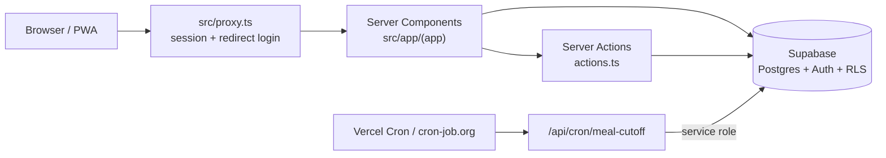

# NutriSmart

PWA untuk manajemen diet dan distribusi makanan pasien rumah sakit: perawat dan ahli gizi mencatat diet tiap pasien, bagian produksi mencetak label dengan QR code, lalu bagian distribusi memindai label untuk konfirmasi pengantaran. Dashboard menampilkan rekap porsi secara real-time per sesi makan.

Semua halaman wajib login, dan apa yang bisa dilihat serta dilakukan user tergantung role-nya.

## Screenshot

<!-- Simpan screenshot di docs/screenshots/ dengan nama file di bawah. Pakai data pasien dummy saja, jangan data pasien asli. -->

| Login | Dashboard |
| --- | --- |
|  |  |
| **Daftar pasien** | **Form pasien** |
|  |  |
| **Detail pasien** | **Cetak label** |
|  |  |
| **Scan** | **Analytics** |
|  |  |
| **Admin: user** | **Admin: cut-off makan** |
|  |  |
| **Dashboard (mobile)** | **Scan (mobile)** |
|  |  |

## Fitur

| Area | Yang bisa dilakukan |
| --- | --- |
| **Pasien** | Tambah dan edit diet pasien (ruangan, jenis diet, alergi, bentuk makanan, frekuensi makan); No. RM unik; riwayat lengkap perubahan diet; close (hapus) pasien. |
| **Label** | Cetak label makanan dengan QR code untuk satu pasien atau banyak sekaligus (`/patients/print-labels`). |
| **Scan** | Pindai QR code label pakai kamera, lalu tandai makanan sudah diantar atau tidak dibagikan. |
| **Dashboard** | Rekap porsi real-time untuk sesi makan saat ini (Pagi / Siang / Sore), status pengantaran tiap pasien, dan notifikasi untuk permintaan mendesak. |
| **Analytics** | Snapshot distribusi hari ini per sesi makan, plus 7 hari terakhir. |
| **Admin** | Kelola user dan role, atur jam cut-off makan, dan atur berapa lama permintaan mendesak tetap ditandai. |

Berlaku di seluruh app: bisa di-install sebagai PWA dengan halaman offline, layout mobile-first, dan semua waktu memakai WIB (`Asia/Jakarta`) apa pun timezone server-nya.

## Role

| Role | Akses |
| --- | --- |
| Perawat | Tambah dan edit diet pasien, lihat riwayat diet. Tidak bisa akses dashboard. |
| Ahli Gizi | Tambah dan edit diet pasien, lihat riwayat diet dan dashboard. |
| Bagian Produksi | Lihat dashboard, cetak label dan QR code (satuan atau massal). |
| Bagian Distribusi | Lihat dashboard, scan QR code dan konfirmasi pengantaran. |
| Admin | Semua akses di atas, plus close pasien serta kelola user dan pengaturan. |

Pengecekan izin ditulis sebagai fungsi murni di `src/utils/roles.ts`, dipakai oleh halaman maupun navigasi. Aturan yang sama juga diterapkan di database lewat Row Level Security (`supabase/migrations/0007_rbac_roles.sql`).

## Tech stack

| Tool | Versi |
| --- | --- |
| Next.js (App Router, build pakai webpack) | 16.2 |
| React | 19.2 |
| TypeScript | 5 |
| Tailwind CSS (token di `src/app/globals.css` `@theme`) | 4 |
| Radix UI primitives, gaya shadcn (`src/components/ui/`) | 1.6 |
| Supabase (Postgres, Auth, RLS) | `@supabase/ssr` 0.12 |
| Serwist (service worker) | 9.5 |
| `@yudiel/react-qr-scanner` / `qrcode` | 2.6 / 1.5 |
| Vitest | 5 |
| Yarn | 1.22 |

Icon memakai Material Symbols Outlined yang di-host sendiri dari `public/fonts/` dan dirender lewat `src/components/Icon`.

## Memulai

**Prasyarat:** Node.js 22.12+ (dibutuhkan Vitest 5), Yarn 1.22, dan satu project Supabase.

```bash
yarn install
cp .env.example .env.local
```

Isi `.env.local`:

| Variabel | Ambil dari | Dipakai untuk |
| --- | --- | --- |
| `NEXT_PUBLIC_SUPABASE_URL` | Supabase → Settings → API | Client Supabase |
| `NEXT_PUBLIC_SUPABASE_ANON_KEY` | Supabase → Settings → API | Client Supabase |
| `SUPABASE_SERVICE_ROLE_KEY` | Supabase → Settings → API → `service_role` | Fitur admin "Tambah User" dan cron job. Khusus server, bypass RLS. |
| `CRON_SECRET` | String acak bebas | Autentikasi `/api/cron/meal-cutoff`. Boleh kosong di lokal. |
| `SUPABASE_DB_URL` | Supabase → Settings → Database → Connection pooler | Hanya untuk menjalankan migration di lokal. Jangan dipasang di production. |

Lalu siapkan database:

1. Jalankan semua file di `supabase/migrations/` **sesuai urutan nomor**, lewat Supabase SQL Editor atau `psql "$SUPABASE_DB_URL"`. App tidak menjalankan migration sendiri.
2. Buat admin pertama: Supabase → Authentication → Users → Add User (centang Auto Confirm), lalu:

   ```sql
   update public.profiles set role = 'admin' where email = 'kamu@example.com';
   ```

   Akun lain bisa dibuat dan diberi role dari `/admin/users`.

```bash
yarn dev
```

Buka **<http://localhost:3002>**.

## Scripts

| Command | Fungsi |
| --- | --- |
| `yarn dev` | Dev server di port 3002 (webpack). |
| `yarn build` | Build production (webpack). |
| `yarn start` | Menjalankan hasil build di port 3002. |
| `yarn lint` | ESLint. |
| `yarn test` | Menjalankan unit test sekali (Vitest). |

## Arsitektur



```text
src/
  app/(app)/        halaman yang butuh login: dashboard, patients, scan, analytics, admin
  app/login/        halaman login
  app/api/cron/     endpoint job cut-off makan
  app/sw.ts         service worker Serwist
  components/       komponen fitur, satu folder per komponen; ui/ berisi Radix primitives
  config/           default cut-off makan, label sesi makan, timezone app
  constants/        master data (ruangan, diet, alergi, status pengantaran), bukan hardcode di form
  libs/supabase/    client browser/server/admin, refresh session, profil user aktif
  libs/meal-cutoff/ job cut-off terjadwal
  utils/            helper murni: role, sesi makan, payload QR pasien
  types/            type bersama
  proxy.ts          request proxy (pengganti middleware di Next 16)
supabase/migrations/  schema, bernomor dan append-only
```

### Sesi makan dan cut-off

Satu hari dibagi menjadi tiga sesi makan: **Pagi**, **Siang**, dan **Sore**. Tiap sesi punya jam cut-off data, jendela distribusi, dan jam cut-off evaluasi. Semuanya disimpan di tabel `meal_cutoffs` dan bisa diubah di `/admin/meal-cutoff`.

`src/libs/meal-cutoff/run-cutoff-job.ts` berjalan terjadwal, dan untuk tiap sesi:

1. **Mengunci rekap** setelah jam cut-off data lewat (baris baru di `meal_period_locks`). Data pasien tetap bisa diedit; perubahan setelahnya masuk ke rekap sesi berikutnya.
2. **Mengambil snapshot distribusi** setelah jam cut-off evaluasi lewat (baris baru di `distribution_snapshots`), yang dibaca oleh halaman Analytics.

Setiap penulisan dicek dulu apakah baris hari ini sudah ada, jadi job aman dijalankan lebih sering dari jadwal cut-off tanpa mengunci dua kali. Kalau ada run yang terlewat, job masih bisa jalan hingga 20 menit setelah cut-off (`CUTOFF_GRACE_MINUTES`).

## Keputusan teknis

- **Semua halaman wajib login.** Akses tamu yang dulu ada sudah dihapus sejak role ditambahkan. `src/proxy.ts` mengarahkan siapa pun tanpa session ke `/login`, kecuali `/api/cron/*` yang mengecek `CRON_SECRET` sendiri.
- **Role dicek dua kali.** Halaman dan navigasi memakai `src/utils/roles.ts`; database mengulang aturan yang sama lewat RLS, jadi panggilan API langsung tidak bisa melewati UI.
- **Service role key hanya di server.** Hanya `src/libs/supabase/admin.ts` yang memakainya, untuk membuat user dan untuk cron job. Key ini tidak pernah diberi prefix `NEXT_PUBLIC_`.
- **Webpack, bukan Turbopack.** Serwist belum sepenuhnya mendukung Turbopack (default Next 16), jadi `dev` dan `build` memakai `--webpack`. Jangan hapus flag itu dari build command di Vercel.
- **Master data ada di `src/constants/`.** Ruangan, jenis diet, alergi, dan status pengantaran diambil dari satu tempat, dan database mencerminkan pilihan yang sama lewat constraint `CHECK` (`0006_patient_master_data.sql`).
- **Migration bersifat append-only.** Jangan edit migration yang sudah dijalankan; buat file baru dengan nomor berikutnya.

## Deployment

App berjalan di Vercel dan memakai project Supabase yang sama dengan lokal (tidak ada database dev terpisah). Pasang env var berikut di Vercel: `NEXT_PUBLIC_SUPABASE_URL`, `NEXT_PUBLIC_SUPABASE_ANON_KEY`, `SUPABASE_SERVICE_ROLE_KEY`, dan `CRON_SECRET`. Jangan tambahkan `SUPABASE_DB_URL`.

- **Jalankan semua migration sebelum deploy.** App tidak menjalankannya otomatis.
- **Keep-alive:** `vercel.json` memanggil `/api/cron/meal-cutoff` sekali sehari (20:00 UTC / 03:00 WIB). Route itu membaca database, jadi project Supabase gratis tidak di-pause karena dianggap tidak aktif. Project yang sudah terlanjur di-pause tetap harus di-restore manual dari dashboard Supabase.
- **Jadwal cut-off:** Vercel Hobby hanya mengizinkan cron sekali sehari, dan itu tidak cukup untuk cut-off. Pakai scheduler eksternal seperti [cron-job.org](https://cron-job.org) untuk mengirim `GET https://<domain>/api/cron/meal-cutoff` dengan header `Authorization: Bearer <CRON_SECRET>` setiap 15 menit.
- **HTTPS wajib** untuk prompt install PWA dan scanner kamera. Vercel sudah menyediakannya.

Langkah lengkap (Vercel CLI atau import dari GitHub) ada di [DEPLOY.md](DEPLOY.md).

## Testing

```bash
yarn test
```

12 test dalam 1 file, semuanya lulus. Test-nya mencakup logika sesi makan (`src/utils/meal-period.test.ts`), misalnya menentukan sebuah timestamp masuk ke sesi mana dalam WIB.

## Keterbatasan

- **Penjadwalan tier gratis.** Job cut-off bergantung pada scheduler eksternal; kalau scheduler berhenti, rekap tidak terkunci dan snapshot tidak diambil.
- **Close pasien adalah hard delete.** Hanya admin yang bisa, dan datanya tidak bisa dikembalikan.
- **Test masih sedikit.** Baru helper sesi makan yang punya test; role, job cut-off, dan form belum.

## Rencana pengembangan

- Unit test untuk `src/utils/roles.ts` dan `run-cutoff-job.ts`.
- End-to-end test (misalnya Playwright) untuk alur input pasien → cetak label → scan.
- Pindahkan jadwal cut-off ke Vercel Cron kalau project upgrade ke Pro.
